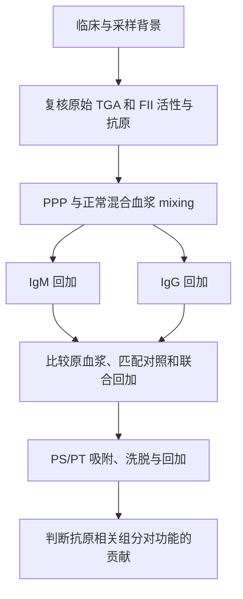

# 课题推理路线

| 阶段 | 当前依据或待检验问题 |
|---|---|
| 临床观察 | 高危 aPL 谱与出血、抗栓不耐受并存。血小板减少也是临床出血解释的一部分。 |
| 已有实验 | PPP 凝血酶生成明显受抑。外源磷脂带来部分恢复，PRP 条件下抑制仍在。依据为现有实验图，待取得原始曲线和重复数据。 |
| 功能线索 | 总 IgM 回加可延迟启动并降低 Peak。原血浆抑制更强，提示还需评估 FII、用药和血浆背景。 |
| 工作假说 | 某些 IgM 可能影响膜依赖的 PT 反应。PS/PT 特异性和作用步骤仍待验证。 |

## 判读原则

混合正常血浆会同时补入凝血因子和稀释抗体。解释结果时结合 FII 活性、抗原量，以及同一血浆终比例下的回加对照。吸附实验同时测量总 IgM、PS/PT 反应性、残留 FII 和 TGA，以判断结合与功能是否随同一组分变化。
